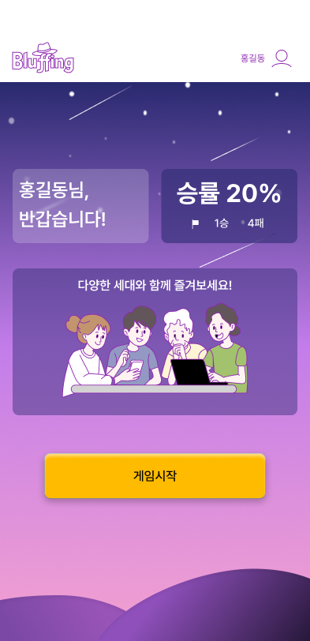
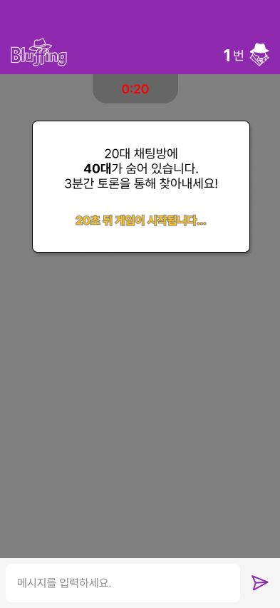
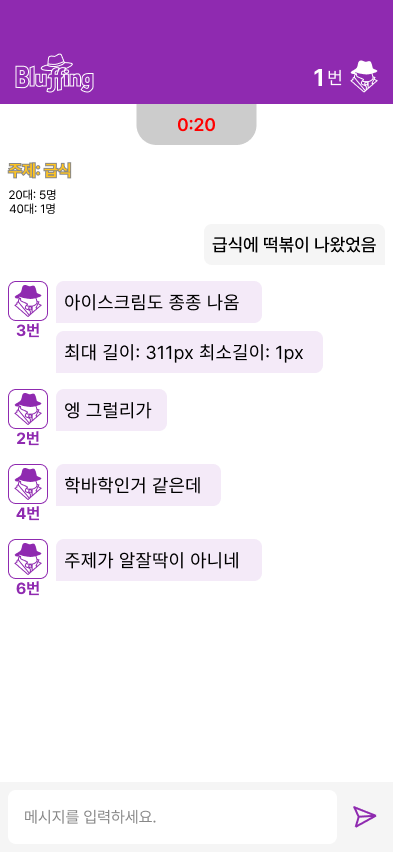
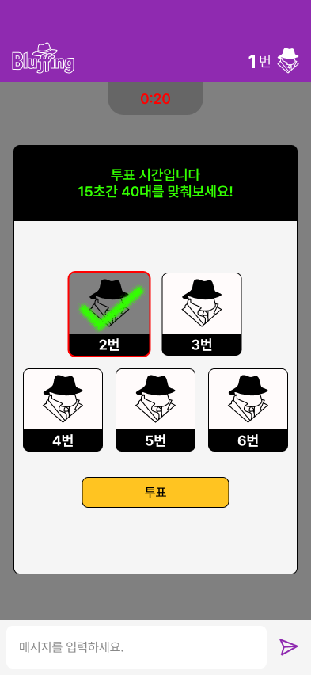
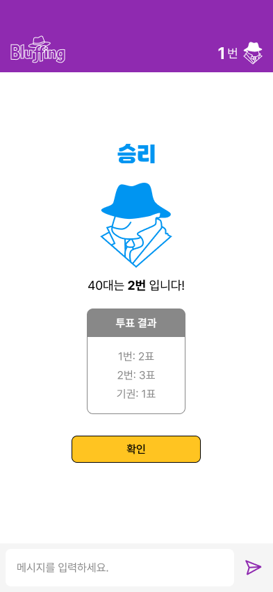

# 🎭 Bluffing

### 세대를 넘어, 서로를 알아가는 실시간 심리 토론 게임

**"서로 다른 세대의 생각이 만나는 순간!"**

20대와 40대가 함께 토론하고,
숨어 있는 상대를 추리하며 서로의 생각을 알아가는
실시간 채팅 및 투표 기반 소셜 게임

 

 

---

## 💜 About Bluffing

**서로 다른 세대의 생각을, 하나의 게임으로 연결하다.**

세대가 다르면 생각과 경험도 달라집니다.
하지만 서로의 생각을 직접 나누고 이해할 기회는 많지 않습니다.

**Bluffing**은 마피아 게임의 추리 요소와 실시간 토론을 결합한
**세대 간 소통형 심리 게임 서비스**입니다.

20대와 40대가 하나의 채팅방에 모여 주어진 주제로 토론하고,
대화 속에 숨어 있는 상대 세대의 참가자를 찾아냅니다.

정해진 시간 동안 자유롭게 의견을 나누고,
투표를 통해 정체를 추리하며 최종 승패를 확인할 수 있습니다.

단순히 상대를 맞히는 게임을 넘어,
**서로 다른 세대의 관점을 발견하고 소통하는 경험**을 제공합니다.

 

## 📱 Service Preview

### 대화하고, 추리하고, 함께 즐기는 Bluffing

 

<table>
  <tr>
    <td align="center"><b>메인 화면</b></td>
    <td align="center"><b>토론 시작</b></td>
    <td align="center"><b>실시간 채팅</b></td>
  </tr>
  <tr>
    <td></td>
    <td></td>
    <td></td>
  </tr>
  <tr>
    <td align="center">게임 시작 및 전적 확인</td>
    <td align="center">세대별 토론 라운드</td>
    <td align="center">실시간 의견 공유</td>
  </tr>
</table>

 

<table>
  <tr>
    <td align="center"><b>정체 추리 및 투표</b></td>
    <td align="center"><b>게임 결과</b></td>
  </tr>
  <tr>
    <td></td>
    <td></td>
  </tr>
  <tr>
    <td align="center">상대 세대 참가자 추리</td>
    <td align="center">승패 및 투표 결과 확인</td>
  </tr>
</table>

 

<!--
## 🎬 Demo Video

### Bluffing 서비스 시연

실시간 채팅부터 토론, 투표, 결과 확인까지
게임의 전체 진행 과정을 소개합니다.

VIDEO_URL

 
-->

## ✨ Key Features

| 기능 | 설명 |
|:---|:---|
| 🎭 **세대별 심리 게임** | 20대와 40대가 함께 참여하여 서로의 정체를 추리하는 게임을 제공합니다. |
| 💬 **실시간 채팅** | WebSocket 기반으로 참가자 간 실시간 토론과 메시지 교환을 지원합니다. |
| ⏱️ **라운드 및 타이머** | 제한된 시간 동안 토론과 투표가 진행되도록 게임 흐름을 관리합니다. |
| 🗳️ **실시간 투표** | 토론을 바탕으로 상대 세대라고 생각하는 참가자에게 투표합니다. |
| 🏆 **결과 및 전적 확인** | 게임 종료 후 승패와 투표 결과를 확인하고 개인 전적을 제공합니다. |

 

## 🛠 Tech Stack

### Frontend

### Backend

### Database & Build

 

## 📂 Repositories

| Repository | Description |
|:---|:---|
| [Backend](https://github.com/chae-ring/2025_SEASONTHON_TEAM_87_BE) | 게임 로직, 실시간 채팅, 인증 및 투표 API |
| [Frontend](https://github.com/chae-ring/2025_SEASONTHON_TEAM_87_FrontEnd) | Flutter 기반 게임 화면 및 실시간 상호작용 |

 

## 👥 Our Team

### Team 87 - Bluffing

**서로 다른 생각을 연결하는 새로운 소통의 방식**

 

<table>
  <tr>
    <th align="center">Role</th>
    <th align="center">GitHub</th>
  </tr>
  <tr>
    <td align="center">Backend · Team Lead</td>
    <td align="center">
      <a href="https://github.com/chae-ring">@chae-ring</a>
    </td>
  </tr>
  <tr>
    <td align="center">Backend</td>
    <td align="center">
      <a href="https://github.com/Jam759">@Jam759</a>
    </td>
  </tr>
  <tr>
    <td align="center">Frontend</td>
    <td align="center">
      <a href="https://github.com/swsw12">@swsw12</a>
    </td>
  </tr>
  <tr>
    <td align="center">Frontend</td>
    <td align="center">
      <a href="https://github.com/kuj7373">@kuj7373</a>
    </td>
  </tr>
</table>

 

---

### 🎭 Bluffing

**다른 세대, 새로운 시선, 하나의 대화.**

Made by **Team 87**

